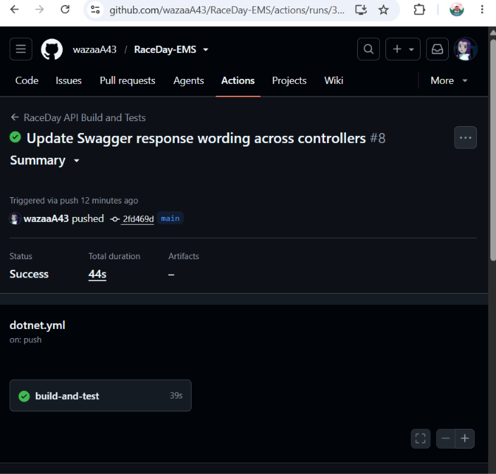

# RaceDay-EMS
RaceDay Event Management System – System Planning, Database and API Development

# Part 2 – RaceDay RESTful API

ASP.NET Core 8 Web API (code in `/API`) using Entity Framework Core (code-first) with SQL Server, server-side session authentication, Swagger, xUnit tests and GitHub Actions CI.

## Setup and run
1. Install the .NET 8 SDK and SQL Server Express.
2. Check the connection string `RaceDayConnection` in `API/RaceDayAPI/appsettings.json`.
3. Create the database: `dotnet tool install --global dotnet-ef` then `dotnet ef database update --project API/RaceDayAPI/RaceDayAPI.csproj`
4. Run the API: `dotnet run --project API/RaceDayAPI/RaceDayAPI.csproj` and open `/swagger` on the URL shown in the console.
5. Run the tests: `dotnet test API/RaceDayAPI.Tests/RaceDayAPI.Tests.csproj`

## Using Swagger
Register, then call the login endpoint. The server creates a session and the browser keeps the session cookie, so all other endpoints work automatically for your role. Call the logout endpoint to end the session and test as an unauthenticated user.

## Roles
- **Organiser:** manages their own events and categories, views all enrolments for their events, captures finish times and positions, and manages their profile.
- **Participant:** views events and categories, enrols in an event by choosing a category, views their own enrolments and results, and manages their profile.

Passwords are hashed. On login the user id and role are stored in a server-side session; `[Authorize(Roles = ...)]` blocks the wrong role (403) and users who are not logged in (401). Logout clears the session.

## CI/CD
Every push builds the API and runs all unit tests with GitHub Actions.

## Demo video
PASTE_YOUTUBE_LINK_HERE
