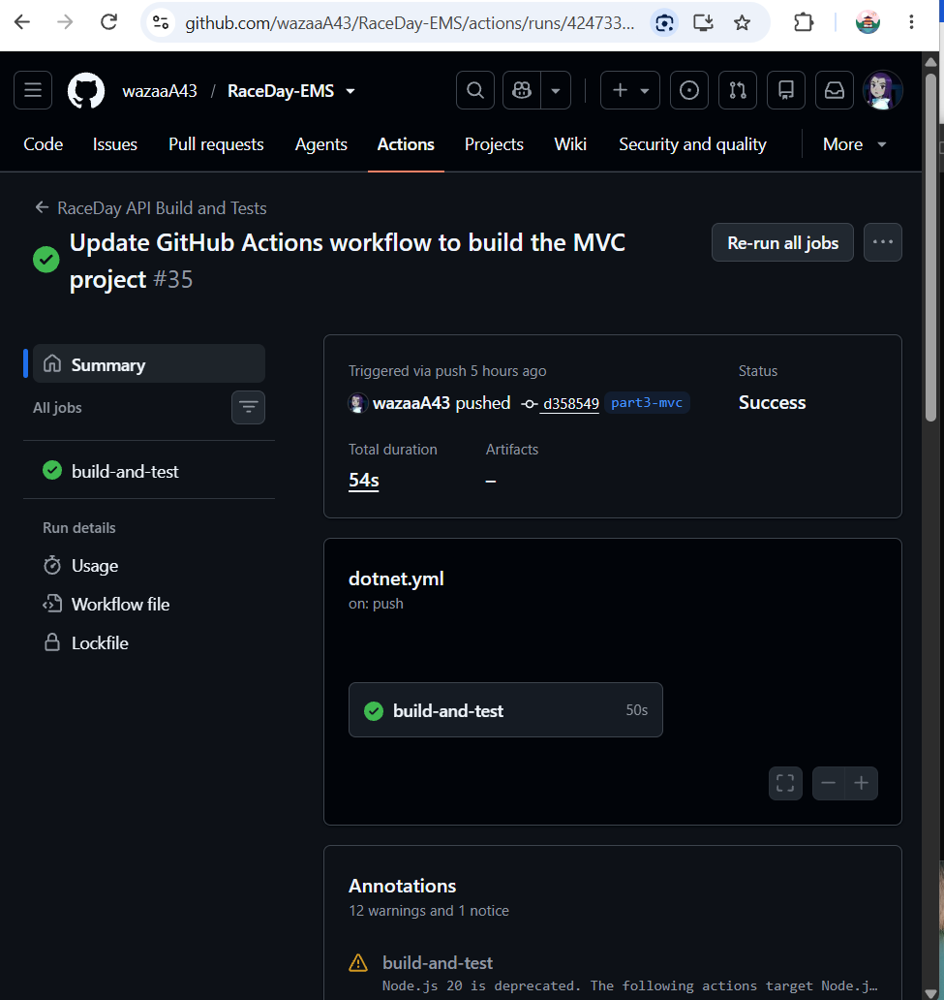

# RaceDay Event Management System (RaceDay-EMS)

RaceDay is an ASP.NET Core Web API (Part 2) with an ASP.NET Core MVC web application (Part 3).

- Part 1 documentation: [docs/README.md](docs/README.md)
- Part 2 README (API): [docs/README-Part2.md](docs/README-Part2.md)
- Part 3 (this README): MVC application, Azure Blob Storage and Docker

# Part 3 – RaceDay MVC Web Application

Part 3 adds an ASP.NET Core MVC web application (`MVC/RaceDayMVC`) that consumes the RaceDay API (`API/RaceDayAPI`). The two projects are separate: each has its own solution and runs on its own address, and they communicate only through HTTP requests. The MVC project contains no database code. Part 3 development was done on the `part3-mvc` branch.

**Demo video (unlisted YouTube):** https://youtu.be/Rx3vzYa7y8k

## How it works

- **MVC to API:** every page gets its data from the API through one service class, `ApiService`. The API address is set in `MVC/RaceDayMVC/appsettings.json` (`ApiSettings:BaseUrl`).
- **Session management:** when a user logs in, the API starts a server-side session and sends a session cookie. The MVC app keeps that cookie, the user id, first name and role in its own server-side session and attaches the cookie to every API request. Passwords are never stored. Logging out ends both sessions. If the API session expires, the user is sent back to the login page.
- **Roles:** the API enforces roles and ownership (an organiser can only manage their own events). MVC also hides pages that do not belong to a role and redirects visitors who are not logged in.
- **Azure Blob Storage:** images are uploaded through the API only. The MVC app never talks to Azure.

## Features

**Participant:** browse and filter upcoming events (name, type, location, date range), view event details, categories and banner, enrol in a category, view and cancel own enrolments (Pending shown amber, Confirmed shown green), view published race results (for example "1st out of 12 finishers"), edit the profile and upload a profile picture.

**Organiser:** dashboard (events, enrolment totals, upcoming dates), create, edit and delete events with a banner image, add and remove categories, view enrolments and confirm them, capture finish times and positions and publish results after the event.

## Prerequisites

.NET 8 SDK, Visual Studio 2022, SQL Server Express, Docker Desktop (for the container) and an Azure Storage account.

## Configuration

| Setting | Project | Purpose |
|---|---|---|
| `ConnectionStrings:RaceDayConnection` | API (`appsettings.json`) | SQL Server connection, database `RaceDayDB` |
| `AzureStorage:ConnectionString` | API (**secret**) | Azure Storage connection string |
| `AzureStorage:ContainerName` | API (optional) | Blob container name, default `raceday-images` |
| `ApiSettings:BaseUrl` | MVC (`appsettings.json`) | Address of the API, `https://localhost:7259/` locally |

### Azure Blob Storage setup

1. In the Azure portal create a **Storage account** (Standard, LRS). On the Advanced tab tick **Allow enabling anonymous access on individual containers**.
2. Open the account, then **Security + networking**, then **Access keys**, and copy the key1 **Connection string**.
3. Store it as a user secret. **Never commit it to GitHub.**

```
dotnet user-secrets set "AzureStorage:ConnectionString" "<your connection string>" --project API/RaceDayAPI/RaceDayAPI.csproj
```

When deployed, use the environment variable `AzureStorage__ConnectionString` instead. The API creates the `raceday-images` container (public read for blobs) on the first upload. 
Uploads must be JPG, PNG or WEBP and 2 MB or smaller; the API checks the file type and size.

## Run locally

1. Check the `RaceDayConnection` connection string in `API/RaceDayAPI/appsettings.json`.
2. Create the database from the repo root:

```
dotnet tool install --global dotnet-ef
dotnet ef database update --project API/RaceDayAPI/RaceDayAPI.csproj
```

3. Start the API with the **https** profile in Visual Studio. It runs at `https://localhost:7259` and Swagger opens.
4. Open `MVC/RaceDayMVC/RaceDayMVC.sln` in a second Visual Studio window and press Start.
5. Use the **Register** page to create an Organiser and a Participant.

The API must be running whenever the MVC app is used.

## Run the MVC app in Docker

Only the MVC application is containerised. The API and SQL Server run on the host computer, 
and the container reaches the API through `host.docker.internal` (inside a container, `localhost` means the container itself).

1. Start the API so it listens on all interfaces (from the repo root):

```
dotnet run --project API/RaceDayAPI/RaceDayAPI.csproj --urls http://0.0.0.0:5199
```

2. Build the image:

```
docker build -t raceday-mvc ./MVC/RaceDayMVC
```

3. Run the container with one command:

```
docker run -d --name raceday-mvc -p 8080:8080 -e ApiSettings__BaseUrl=http://host.docker.internal:5199/ raceday-mvc
```

4. Open **http://localhost:8080**.
5. Stop it with `docker stop raceday-mvc`, then `docker rm raceday-mvc`.

Notes: if Windows Firewall blocks the connection, allow inbound TCP port 5199. 
On Linux add `--add-host=host.docker.internal:host-gateway` to the `docker run` command.

## Tests and continuous integration

```
dotnet test API/RaceDayAPI.Tests/RaceDayAPI.Tests.csproj


```

There are 72 unit tests. GitHub Actions (`.github/workflows/dotnet.yml`) builds the API, builds the MVC application and runs the tests on every push.



## Project structure

```
RaceDay-EMS/
├── API/
│   ├── RaceDayAPI/          Web API (API/RaceDayAPI/RaceDayAPI.sln)
│   └── RaceDayAPI.Tests/    xUnit tests
├── MVC/
│   └── RaceDayMVC/          MVC web app, its own solution, Dockerfile
├── .github/workflows/       CI workflow
└── docs/                    READMEs and screenshots
```

## Part 3 API additions

`POST /api/event/{id}/banner`, `POST /api/participant/profile-picture`, `PUT /api/enrolment/{id}/status`, `POST /api/result/event/{id}/publish`, 
and `GET /api/participant/results` (published results only, with finisher counts). Create and update requests now use small request classes so 
Swagger shows only the fields a user has to fill in.

## Credits

Logo: SVG created with the help of Claude (Anthropic's AI assistant).
